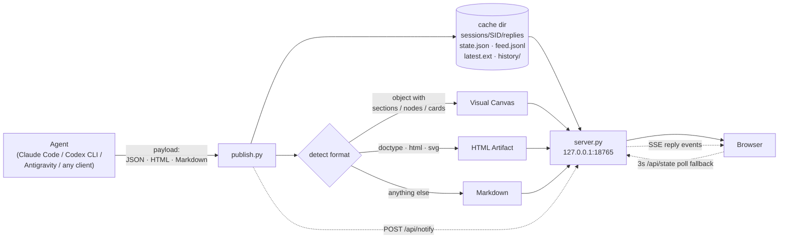

# Visual Reply

[](https://github.com/kyrie21z/visual-reply/actions/workflows/ci.yml)
[](https://www.python.org/)
[](LICENSE)

**Turn an AI agent's wall of terminal text into a local, interactive visual page.**

Visual Reply is a skill for terminal/CLI coding agents. Instead of printing a 600-word
answer into a scrollback buffer, the agent publishes a structured payload to
`http://127.0.0.1:18765` and keeps only the conclusion plus a link in the terminal.
Charts, topology maps and scorecards render in the browser; every long explanation is
folded into a side drawer until someone clicks it. Run several agents at once and they
land in separate session lanes in the same page, without stepping on each other.
Long-running jobs can instead publish a **live board** that updates in place — same id,
fresh content, no reply spam.

Runs on the Python 3.10+ standard library. No pip install, no API key, no telemetry,
no network calls of its own.

[中文文档](README_CN.md)

---

## Why Visual-First, Not Text Walls

A terminal is a bad reading surface. It is one narrow column with no layout, no
color semantics, and no way to compare two things side by side. The longer an agent's
answer gets, the worse it becomes:

- **Comparison collapses.** Two options with six dimensions each become twelve
  paragraphs that the reader has to hold in working memory. A scored two-column card
  makes the same decision readable at a glance.
- **Structure is lost.** An architecture description written as prose forces the reader
  to reconstruct the graph in their head. A topology diagram does that work for them.
- **Detail crowds out the conclusion.** Most of a long answer is justification for a
  one-line recommendation. Interleaving them means the reader scrolls past the answer
  to find the caveat, then scrolls back.
- **Nothing is revisitable.** Scrollback gets clobbered by the next command. A local
  page with 20 archived entries stays put.

Visual Reply enforces a two-tier reading model: **the first screen holds no long
sentences** — only numbers, nodes and scores. Everything else lives in the `details`
field of each element and opens in a right-hand Inspector drawer. That constraint is
the product; the renderer is just how it is delivered.

---

## Features

### Three payload modes

| Mode | Format | What you get |
| --- | --- | --- |
| **Visual Canvas** | `json` | Declarative page built from eight component types. Scrollable, clickable, no CSS required. |
| **HTML / SVG Artifact** | `html` | Your own markup rendered inside a sandboxed `allow-scripts` iframe, with a source view toggle. |
| **Markdown** | `md` | Reading / mind-map / split views with Mermaid diagrams, heading folding and tables. |

### Eight canvas components

| `type` | Shape | Use it for |
| --- | --- | --- |
| `kpis` | Metric cards, large number + status dot | Lead with the numbers |
| `graph` | Layered node topology, SVG bezier edges | Architecture, call chains, dependencies, state machines |
| `comparison` | Option cards with 1–5 score bars | Technology selection, trade-off reviews |
| `bento` | Bento grid with spanning cards | Parallel modules or capability overview |
| `steps` | Horizontal stage progress bar | Migrations, execution plans, debugging paths |
| `table` | Scientific table with grouped headers, best/second marks, baseline Δ, search, sort and LaTeX / Markdown / CSV export | Benchmarks, ablations, parameter grids |
| `chart` | Offline SVG bar / line / scatter / heatmap with tooltips, legend toggles and Pareto frontiers | Trends, distributions, trade-offs, ablation matrices |
| `prose` | Markdown card with tables and external links | Conclusions, method notes, limitations |

### Scientific canvas

Tables and charts are rendered entirely offline — no Chart.js, ECharts or DataTables,
no CDN, no extra dependency. On desktop the canvas uses a two-column grid; sections with
`"span": 1` sit side by side and collapse to one column in split view or below 960 px.

- **Table** — click a header to sort (missing values always sink to the bottom); the
  search box filters rows while keeping focus. `设为基准` switches the baseline row in
  place and recomputes every Δ badge without opening the drawer; clicking the row itself
  opens the Inspector. `LaTeX` emits a `booktabs` table (`\toprule`, `\midrule`,
  `\textbf`, `\underline`, `\multicolumn`), `Markdown` and `CSV` escape per RFC 4180.
  If the clipboard API is unavailable, the export always remains visible in a preview
  box under the table.
- **Chart** — legend pills toggle series; lines split into separate SVG path segments at
  `null` gaps; scatter plots can mark a Pareto frontier (`max_y_min_x`, `max_xy`,
  `min_xy`) with non-colliding labels; heatmaps normalize into a 0–1 intensity range
  with `max_good`, `min_good` or `neutral` scaling.
- **Prose** — reuses the Markdown renderer, including table wrapping and external-link
  hardening.

The topology renderer handles layout automatically:

- **Content-aware column gaps** — the gap between two layers is sized from that
  layer's longest edge label (108–230 px), so labels never sit on top of nodes.
- **Barycentric ordering** — nodes in a column are sorted by the mean row of their
  predecessors (one forward pass, one reverse), which removes most edge crossings.
- **Bypass routing** — edges that skip a layer run above the diagram; back-edges and
  self-loops run below. Tracks are spaced 34 px apart and the canvas grows to fit, so
  no edge ever cuts through an intermediate node.
- **Labels in their own layer** — edge labels are capsules at `z-index: 3`, never
  sliced by a node card, and multiple labels in one gap are pushed apart vertically.
- **Zoom toolbar** — *fit / 100% / − / +*, implemented with `transform: scale()`;
  a six-column diagram fits on one screen at 0.35×.

### Click-to-drill drawer

Every node, card and step can carry `details` (Markdown) and `files` (monospace chips).
Clicking opens an Inspector drawer on the right with full prose, code blocks and the
file list. `Esc` or `×` closes it. Hovering a node highlights its upstream and
downstream edges.

### Multi-session workbench

Every publish is attributed to a session, derived with zero configuration:
`--session` → `VISUAL_REPLY_SESSION` → the client's own thread variables
(`ANTIGRAVITY_CONVERSATION_ID`, `CODEX_THREAD_ID`, `OPENCODE_SESSION_ID`,
`GEMINI_SESSION_ID`, `CLAUDE_SESSION_ID`) → terminal multiplexer pane (`WT_SESSION`,
`TMUX_PANE`, `WEZTERM_PANE`, `KITTY_WINDOW_ID`, `ITERM_SESSION_ID`) → a hash of the parent
process and project root. Same shell stays in one lane; a different terminal gets its own.

- **3-level sidebar tree** — collapsible left rail organized as a dedicated **Pinned (`★ 置顶`)** section at the top, followed by **Project → Session → Reply** folders. Projects and sessions stay anchored in fixed creation order (newest at top, never jumping when background agents reply), and expanding any session lists its rounds newest-first (`#N (latest)` at top). Filter by *all / unread / pinned*, or open the **global timeline** across every session. Collapse it with the in-rail close button, the topbar **会话** toggle, or `Ctrl+B` (`Cmd+B` on macOS); keyboard focus returns to the toggle when the rail closes.
- **Focus lock** — the default once a session is focused (via a deep link or a click in
  the rail). A reply from another session never hijacks the pane you are reading; it
  marks that lane unread and shows a clickable toast instead. Switch to *follow global*
  from the top bar when you want the newest reply to take over.
- **Reading guard** — even inside the focused session, a new reply will not close the
  Inspector drawer or replace a historical round you are re-reading. It shows a banner:
  *this session has a new reply → jump to latest*.
- **Split view** — `◫` on any session card opens a second pane. Both panes keep their own
  session, view mode and reply history, and share one Inspector drawer.
- **Reply rounds** — the history dropdown lists that session's rounds
  (`#3 (latest) · title`, `#2 · title`, …) plus the legacy v3 archive.

Deep links: `?session=<sid>&reply=<rid>`, plus optional `&split=<sid2>`, `&layout=h|v`
and `&mode=lock|global`. The `url` in every publish receipt is already such a link.

### Live Boards

Not every answer is a one-shot reply. Training progress, a CI build, a long-running job —
these want **one board that keeps refreshing**, not twenty archived rounds. Pass `--board`
and every publish with that ID overwrites the same board in place:

```bash
# First publish creates the board
python3 scripts/publish.py --title "Build status" --stdin \
  --board ci-live --board-name "CI build" --project "Release" --ttl 120 <<'JSON'
{
  "headline": "build 4821 · 3/5 stages green",
  "sections": [
    { "type": "table",
      "columns": [
        { "key": "stage", "label": "Stage" },
        { "key": "progress", "label": "Progress", "bar": true, "max": 100, "unit": "%" },
        { "key": "tests", "label": "Tests", "decimals": 0 }
      ],
      "rows": [
        { "id": "lint", "stage": "lint", "progress": { "value": 100, "sub": "done", "status": "ok" }, "tests": 0 },
        { "id": "unit", "stage": "unit", "progress": { "value": 78, "sub": "1402/1798" }, "tests": 1402 }
      ] }
  ]
}
JSON

# Every heartbeat: same --board, fresh content
python3 scripts/publish.py --title "Build status" --stdin \
  --board ci-live --ttl 120 <<'JSON'
{ "headline": "build 4821 · 4/5 stages green", "sections": [ … ] }
JSON
```

- **Isolated from replies.** A board never writes `latest.*`, `meta.json`, `history/`,
  `sessions/` or the reply feed, so it cannot pollute the global timeline and cannot
  hijack a pane. The reply stream and the board stream share the global `seq` but land
  in separate event files; SSE frames are tagged `event: reply` or `event: board`.
- **Sticky metadata.** A custom `--board-name` persists after the first publish; later
  heartbeats only need the ID and the payload. `--project` applies on every heartbeat
  (defaults to the session's project).
- **Health state machine.** With `--ttl <seconds>` the rail card and the pane header
  derive a health state from the board's age: `LIVE` (age ≤ ttl), `STALE`
  (ttl < age ≤ 2×ttl), `OFFLINE` (older). `--board-status complete` pins `DONE`,
  `--board-status err` pins `ALERT`; a TTL-less board shows `BOARD`, or `WARN` when
  published with `--board-status warn`. Relative times recompute locally every 5 s with
  no network traffic.
- **Rail cards.** Boards appear in the same pinned / project folders as sessions, with
  health dot, `📊`, update count and relative age. Hover for `★/☆` pin, `改` rename and
  `◫` split; the split target list gets its own *实时面板* group.
- **In-place refresh.** When a `event: board` frame arrives for the board you are
  currently viewing, only that pane re-renders — scroll position, table sort/search/
  baseline, hidden chart series, topology zoom and the open Inspector drawer all
  survive. Other panes only see the rail dot update.
- **Inline table meters.** `"bar": true` on a column or cell draws a progress meter,
  `max` sets the full-bar value and `sub` adds a small sub-line. Exports (LaTeX /
  Markdown / CSV) stay numeric.
- **Deep links.** `?board=<bid>` focuses a board; `?split=board:<bid>` opens it in the
  secondary pane. Board receipts already contain `?board=`.

### Live reload

`publish.py` POSTs `/api/notify` after committing, so an open tab updates in well under a
second over Server-Sent Events. A 3-second `/api/state?since=` poll remains as a fallback
if SSE drops. Neither causes a manual reload or a scroll jump.

### Everything else

- Light / dark theme toggle, persisted per browser.
- Every publish is archived per session and projected into the v3 `history/` layout,
  selectable from the dropdown; the last 20 legacy entries stay addressable.
- Old service versions are detected on the port and replaced automatically (`SIGTERM`,
  then relaunch).
- The server binds `127.0.0.1` only.
- Length linting on publish: an over-long `headline` or `edge.label` comes back as a
  `warnings` array. It never blocks the publish and the exit code stays `0`.

---

## Architecture



`publish.py` is the only writer: it resolves the session, takes an advisory lock on
`.publish.lock`, commits the reply under `sessions/<sid>/replies/`, updates `state.json`
and `global/feed.jsonl`, mirrors the v3 `latest.<ext>` / `meta.json` / `history/`
projection, starts `server.py` in the background if the port is idle, then wakes SSE.
`server.py` is stateless apart from the cache directory, so it can be restarted at any
time.

---

## Requirements

- **Python 3.10+** — that is the whole dependency list. Nothing is installed.
- **Node.js** — optional, only used by the test suite for the geometry assertions.
  Those tests are skipped, loudly, when `node` is missing.
- A desktop session for auto-opening the browser. On a headless box the page is still
  served; just open the URL yourself or pass `--no-browser`.

---

## Install

### As a skill (recommended)

```bash
npx skills add kyrie21z/visual-reply
```

### Manual install

Clone once, then link the checkout into whichever client you use. A symlink keeps
future `git pull`s effective without re-copying files.

```bash
git clone https://github.com/kyrie21z/visual-reply.git ~/src/visual-reply

# Claude Code
mkdir -p ~/.claude/skills
ln -s ~/src/visual-reply ~/.claude/skills/visual-reply

# Codex CLI
mkdir -p ~/.codex/skills
ln -s ~/src/visual-reply ~/.codex/skills/visual-reply

# Antigravity
mkdir -p ~/.gemini/antigravity-cli/skills
ln -s ~/src/visual-reply ~/.gemini/antigravity-cli/skills/visual-reply

# Generic / any other client that reads ~/.agents/skills
mkdir -p ~/.agents/skills
ln -s ~/src/visual-reply ~/.agents/skills/visual-reply
```

On Windows, use a directory junction from an elevated prompt:

```bat
mklink /D "%USERPROFILE%\.claude\skills\visual-reply" "%USERPROFILE%\src\visual-reply"
```

Clients that do not support skills can still use it as a plain CLI — see below.

---

## Quickstart

Publish a canvas from stdin. This is a complete, runnable one-liner:

```bash
echo '{"headline":"Plan B: 12 files, no new deps","sections":[{"type":"kpis","items":[{"label":"Files changed","value":"12","status":"ok"},{"label":"New deps","value":"0","status":"ok"},{"label":"Rollback","value":"90s","status":"warn"}]},{"type":"comparison","title":"Options","items":[{"name":"Plan A: new service","scores":{"Speed":2,"Risk":4},"cons":["New deploy target"]},{"name":"Plan B: extend the hub","badge":"Recommended","recommended":true,"scores":{"Speed":4,"Risk":2},"pros":["No new deploy target"]}]}]}' | python3 scripts/publish.py --title "Ship plan B" --stdin
```

The receipt on stdout looks like this (trimmed):

```json
{
  "ok": true,
  "format": "json",
  "title": "Ship plan B",
  "url": "http://127.0.0.1:18765/?session=codex-7f3a&reply=20260101-120000-000001-Ship-plan-B",
  "session_id": "codex-7f3a",
  "reply_id": "20260101-120000-000001-Ship-plan-B",
  "seq": 1,
  "session_url": "http://127.0.0.1:18765/?session=codex-7f3a",
  "server": "started",
  "browser": "xdg-open"
}
```

Publish again and the open tab updates in place, usually in well under a second.

Other entry points:

```bash
# From a file, explicit format
python3 scripts/publish.py --title "Call chain" --format json --file canvas.json

# Custom HTML demo, sandboxed in an iframe
python3 scripts/publish.py --title "Prototype" --format html --file demo.html

# Long-form prose, rendered with Mermaid and a mind map
python3 scripts/publish.py --title "Notes" --format md --file notes.md

# Start the server on its own
python3 scripts/server.py --port 18765
```

Use `${SKILL_DIR}/scripts/publish.py` when the working directory is not the repo root;
`SKILL.md` documents the variable and how to set it per shell.

---

## Canvas schema

Everything except `type` is optional.

```json
{
  "title": "Falls back to headline",
  "headline": "One sentence, largest type on the page",
  "badges": ["Plain string", { "text": "Decision ready", "tone": "ok" }],
  "sections": [
    {
      "type": "graph",
      "title": "Call chain",
      "nodes": [
        {
          "id": "cli", "label": "CLI entry", "tag": "cli", "layer": 0, "status": "ok",
          "summary": "Parses flags and reads the payload",
          "details": "## Detail\n\nSupports `--stdin` and `--file`.",
          "files": ["scripts/publish.py"]
        }
      ],
      "edges": [{ "from": "cli", "to": "store", "label": "content" }]
    }
  ]
}
```

| Field | Values | Notes |
| --- | --- | --- |
| `status` (node, kpi) | `ok` `warn` `err` `info` | Status dot, defaults to `info` |
| `status` (step) | `done` `active` `pending` | Progress bar colors |
| `tone` (card) | `accent` `ok` `warn` `err` | Bento border and accent |
| `span` (card) | `1` `2` | Columns in a 4-column grid |
| `scores` | `{ "dimension": 1..5 }` | Rendered as bars; do not also write prose |
| `layer` | integer from 0 | Auto-derived from edges when omitted |
| `details` | Markdown string | Rendered in the Inspector drawer |
| `files` | array of strings | Monospace chips in the drawer |
| `node.label` | ≤ 12 chars | Two-line clamp, then ellipsis |
| `edge.label` | ≤ 10 chars | Capsule label; over 14 chars raises a warning |
| `span` (section) | `1` `2` | Two-column grid: one column or full width |
| `columns[]` | `key`, `label`, `align`, `highlight`, `higher_is_better`, `decimals`, `unit`, `delta_unit`, `bar`, `max` | Table column spec; `higher_is_better` drives best/second marks and Δ tone; `bar: true` renders an inline meter, `max` sets the full-bar value |
| `rows[]` | `id`, `cells`, `is_baseline`, `emphasis`, `divider_before`, `details`, `files` | A cell is a primitive or `{value, display, note, status, bar, max, sub}`; `sub` is a small sub-line, exports use the numeric value only |
| `chart_type` | `bar` `line` `scatter` `heatmap` | Defaults to `bar` |

A top-level `{ "headline": …, "nodes": [...], "edges": [...] }` is accepted as a
shortcut for a single graph; the same applies to `cards`. A table can put `columns` and
`rows` at the top level, and a chart can put `chart_type` (or `matrix` + `x_labels`) at
the top level. A payload is auto-detected as JSON when it parses as an object containing
`sections`, `nodes`, `cards`, `columns`+`rows`, `chart_type`, or `matrix`+`x_labels`;
a prose-only payload needs an explicit `--format json`.

---

## CLI reference

| Flag | Description |
| --- | --- |
| `--title` | Page title. Defaults to the JSON `title`/`headline`, the HTML `<title>`, or the first Markdown `# heading` |
| `--format` | `auto` (default) / `json` / `html` / `md` |
| `--file` | Read the payload from a file |
| `--stdin` | Read the payload from stdin (also implied when stdin is not a TTY) |
| `--no-browser` | Do not open a browser |
| `--port` | Server port, default `18765` |
| `--cache-dir` | Cache directory, default `~/.cache/agent-visual-reply` |
| `--public-url` | Public HTTPS base URL for receipts (e.g. `https://vr.example.com`); falls back to `VISUAL_REPLY_PUBLIC_URL`, then `<cache-dir>/config.json` |
| `--session` | Session id; skips auto-detection, rejected if unsafe |
| `--session-name` | Human-readable session label, persisted in `session.json` |
| `--agent` | Client badge (`codex`, `claude`, `antigravity`, …) |
| `--board` | Live board id; repeated publishes with the same id update it in place instead of appending a reply |
| `--board-name` | Board label (sticky: persisted after the first publish) |
| `--project` | Explicit project folder name, for boards and sessions |
| `--ttl` | Freshness window in seconds; `0` (default) means a static board |
| `--board-status` | Optional status hint: `ok` / `warn` / `err` / `complete` |
| `--open-browser` | Force the browser open in board mode (reply mode already does) |

### Public URLs

When the page is exposed through a tunnel or reverse proxy, tell `publish.py` the public
base once — `--public-url https://vr.example.com`, the `VISUAL_REPLY_PUBLIC_URL`
environment variable, or `{"public_url": "https://vr.example.com"}` in
`<cache-dir>/config.json` (earlier sources win). The value must be `http` / `https` with a
host; query, fragment and trailing slashes are dropped, and an invalid value safely falls
back to local links. Receipts then use the public deep link in `url` / `base_url` /
`session_url`, expose the local equivalents as `local_url` / `local_base_url` /
`local_session_url`, and report `public_url` / `public_base_url` (`null` when unset).
The browser is always opened against the local address.

Cache layout:

```text
~/.cache/agent-visual-reply/
├── .publish.lock                          # write lock (flock / msvcrt.locking)
├── .server.lock                           # startup lock: one cold-start at a time
├── state.json                             # version 7, seq, latest session/reply pointers
├── sessions/
│   └── <sid>/
│       ├── session.json                   # label, client, project, pinned, seq, reply_count
│       └── replies/
│           ├── 20260101-120000-000001-title.md
│           └── 20260101-120000-000001-title.md.meta.json
├── boards/                                # v7 live boards: one directory per board
│   └── <bid>/
│       ├── board.json                     # label, project, pinned, ttl_sec, status_hint, update_count, seq
│       └── payload.json | .md | .html     # overwritten in place; stale extensions removed
├── global/feed.jsonl                      # append-only cross-session reply timeline
├── global/board_events.jsonl              # board events, capped at the last 200 lines
├── latest.json | latest.html | latest.md  # v3 projection, exactly one per format
├── meta.json                              # v3 projection + seq / session_id / reply_id
├── server.log
└── history/                               # v3 projection, still read by old clients
    ├── 20260101-120000-title.json
    ├── 20260101-120000-title.json.meta.json
    └── 20260101-090000-older.md
```

`reply_id` is `<stamp>-<seq:06d>-<ascii-slug>`: sortable, unique under concurrency and
safe to drop straight into a URL. Replies and boards share `state.json`'s `seq` but keep
separate event logs, so `/api/feed` and the rail timeline never contain board churn.

---

## HTTP API

| Endpoint | Returns |
| --- | --- |
| `GET /` | The single-page app |
| `GET /api/latest` | `{version, format, title, content, mtime, updated_at}` |
| `GET /api/history` | `{version, items: [...], count}`, newest 20 |
| `GET /api/history/<filename>` | `{format, title, content, updated_at, mtime}` |
| `GET /artifact/latest` | Raw HTML artifact, `text/html; charset=utf-8`; 404 for other formats |
| `GET /artifact/history/<filename>` | Raw historical HTML artifact |
| `GET /api/sessions` | `{version, seq, latest_session_id, sessions, boards, legacy_count}`, pinned first then newest |
| `GET /api/sessions/<sid>/replies?limit=200` | Reply rounds of one session, newest first |
| `GET /api/sessions/<sid>/replies/<rid>` | `{version, session, reply, content}` |
| `GET /api/boards` | `{version, seq, boards, count}` |
| `GET /api/boards/<bid>` | `{version, board, content}`; 400 for an unsafe id, 404 when missing |
| `POST /api/boards/<bid>` | Update `{label, pinned}`; 400 / 404 as above |
| `GET /artifact/board/<bid>` | Raw HTML board, `text/html; charset=utf-8`; 404 for other formats |
| `GET /api/feed?limit=50` | Cross-session reply timeline, including un-sessioned v3 archives |
| `GET /api/state?since=<seq>` | Incremental reply + board events, merged by seq |
| `GET /api/events` | SSE stream (`text/event-stream`, 20 s keepalive); `event: reply` or `event: board` |
| `POST /api/notify` | Wake SSE immediately after a publish |
| `POST /api/sessions/<sid>` | Update `{label, pinned}` atomically |
| `GET /artifact/session/<sid>/<rid>` | Raw HTML for one session reply |
| `GET /healthz` | `{ok, service, version, pid, port, cache_dir, seq}` |

---

## Tests

```bash
python3 scripts/test_visual_reply.py
```

The suite is end-to-end: it spins up real servers on free ports against throwaway
directories and tears everything down afterwards. It covers all three formats, auto
detection, component metadata, frontend presence checks, the artifact endpoints,
mixed-format history ordering, path traversal defence, old-version takeover, length
warnings, and the open-source hygiene scan. With `node` available it additionally
executes the pure geometry core of the page against a six-column cyclic graph and
asserts that nothing overflows, overlaps or clips.

v4 adds: session isolation for every detection source and receipt deep-link format;
an 8-process concurrent publish stress test across 3 sessions (all exit 0, no lost
replies, seq `1..8`, every sidecar valid JSON); SSE connect → live push under 2 s →
`/api/state` catch-up → `SIGTERM` under 1.5 s with a client still attached; session
pin/rename plus traversal rejection on `/api/sessions/..` and `/artifact/session/..`;
and structural assertions that the workbench keeps exactly one copy of each renderer.

v6 adds: `TableCore` in a Node VM (tie-aware ranking, Δ direction for both
higher/lower-is-better columns, missing values sinking on every sort direction, LaTeX
`booktabs` escaping, Markdown and RFC 4180 CSV) and `ChartCore` (nice scales for normal,
negative, constant and empty ranges, bar bounds, line path splitting across `null` gaps,
hidden-series toggles, Pareto frontiers, normalized heatmaps), plus a full scientific
canvas publish/read-back round trip and shorthand table/chart/prose detection.

v7 adds: the board health state machine and relative-time formatter in a Node VM
(every health branch, TTL boundaries, epoch vs. ISO timestamps, `刚刚`/`s`/`m`/`h`
formatting); board-aware rail tree (pinned boards, project-only groups, unread filters,
pinned boards never counted twice); inline table meters (`bar` / `max` / `sub` parsing
and numeric-only exports); an idempotent board publish round trip proving replies stay
untouched (`latest.*`, `meta.json`, `history/` and the reply feed never change), board
list/read/pin/rename endpoints, traversal rejection on `/api/boards/..` and
`/artifact/board/..`, `event: board` SSE delivery, and the HTML board artifact route.

No network access is required.

---

## Troubleshooting

| Symptom | Fix |
| --- | --- |
| `ok: false`, exit code 2, port in use | Something else owns the port; pass `--port 18800` |
| Old service not replaced | Health check without a `pid` refuses takeover; kill the process manually |
| Server will not start | Read the tail of the error output, then `~/.cache/agent-visual-reply/server.log` |
| Blank canvas | The JSON root must be an object with `sections`, `nodes` or `cards`; unparseable JSON falls back to Markdown |
| Bad automatic layering | Set `layer` explicitly — do not let a cyclic graph be inferred |
| Wide diagram clipped | Use the *fit* button in the diagram's top-right corner (down to 0.35×) |
| Mermaid or mind map missing | Markdown mode loads `marked`, `mermaid` and `markmap` from jsDelivr; offline it degrades to plain text. The JSON canvas needs no CDN except for Markdown inside drawers |
| Content changed but the page did not | Publish to the same port and `--cache-dir`; the status dot should read *synced* |
| New reply does not appear automatically | The dot shows *reconnecting* when SSE drops — a 3 s poll takes over; `/api/events` may be blocked by a proxy |
| One agent shows up as several sessions | The parent process or terminal pane changed between calls; pin it with `--session` / `--session-name` |
| Publish lands in the wrong session | A stale client env var (`CODEX_THREAD_ID`, `CLAUDE_SESSION_ID`, …) is present; `--session` always wins |
| A board stays `OFFLINE` | Each heartbeat must pass the same `--board`, and `--ttl` should be at least twice the heartbeat interval |
| A board update replaced the pane you were reading | It should not: under focus lock only a pane already showing that board re-renders in place. If the tab is in *follow global* mode, switch back to *lock* |

---

## License

MIT © 2026 kyrie21z — see [LICENSE](LICENSE).
