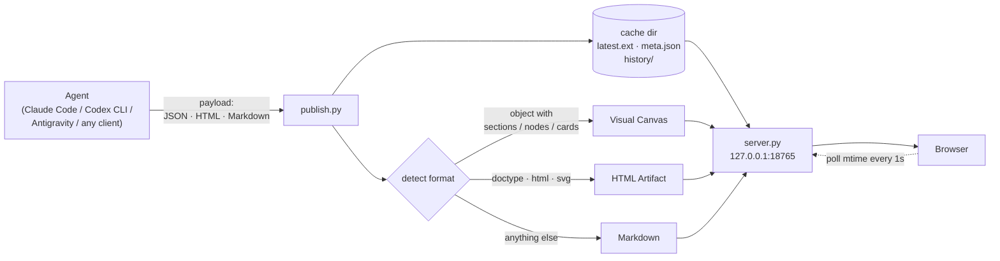

# Visual Reply

[](https://github.com/kyrie21z/visual-reply/actions/workflows/ci.yml)
[](https://www.python.org/)
[](LICENSE)

**Turn an AI agent's wall of terminal text into a local, interactive visual page.**

Visual Reply is a skill for terminal/CLI coding agents. Instead of printing a 600-word
answer into a scrollback buffer, the agent publishes a structured payload to
`http://127.0.0.1:18765` and keeps only the conclusion plus a link in the terminal.
Charts, topology maps and scorecards render in the browser; every long explanation is
folded into a side drawer until someone clicks it.

Runs on the Python 3.10+ standard library. No pip install, no API key, no telemetry,
no network calls of its own.

[中文文档](README_CN.md)

---

## Why Visual-First, Not Text Walls

A terminal is a bad reading surface. It is one narrow column with no layout, no
color semantics, and no way to compare two things side by side. The longer an agent's
answer gets, the worse it becomes:

- **Comparison collapses.** Two options with six dimensions each become twelve
  paragraphs that the reader has to hold in working memory. A scored two-column card
  makes the same decision readable at a glance.
- **Structure is lost.** An architecture description written as prose forces the reader
  to reconstruct the graph in their head. A topology diagram does that work for them.
- **Detail crowds out the conclusion.** Most of a long answer is justification for a
  one-line recommendation. Interleaving them means the reader scrolls past the answer
  to find the caveat, then scrolls back.
- **Nothing is revisitable.** Scrollback gets clobbered by the next command. A local
  page with 20 archived entries stays put.

Visual Reply enforces a two-tier reading model: **the first screen holds no long
sentences** — only numbers, nodes and scores. Everything else lives in the `details`
field of each element and opens in a right-hand Inspector drawer. That constraint is
the product; the renderer is just how it is delivered.

---

## Features

### Three payload modes

| Mode | Format | What you get |
| --- | --- | --- |
| **Visual Canvas** | `json` | Declarative page built from five component types. Scrollable, clickable, no CSS required. |
| **HTML / SVG Artifact** | `html` | Your own markup rendered inside a sandboxed `allow-scripts` iframe, with a source view toggle. |
| **Markdown** | `md` | Reading / mind-map / split views with Mermaid diagrams, heading folding and tables. |

### Five canvas components

| `type` | Shape | Use it for |
| --- | --- | --- |
| `kpis` | Metric cards, large number + status dot | Lead with the numbers |
| `graph` | Layered node topology, SVG bezier edges | Architecture, call chains, dependencies, state machines |
| `comparison` | Option cards with 1–5 score bars | Technology selection, trade-off reviews |
| `bento` | Bento grid with spanning cards | Parallel modules or capability overview |
| `steps` | Horizontal stage progress bar | Migrations, execution plans, debugging paths |

The topology renderer handles layout automatically:

- **Content-aware column gaps** — the gap between two layers is sized from that
  layer's longest edge label (108–230 px), so labels never sit on top of nodes.
- **Barycentric ordering** — nodes in a column are sorted by the mean row of their
  predecessors (one forward pass, one reverse), which removes most edge crossings.
- **Bypass routing** — edges that skip a layer run above the diagram; back-edges and
  self-loops run below. Tracks are spaced 34 px apart and the canvas grows to fit, so
  no edge ever cuts through an intermediate node.
- **Labels in their own layer** — edge labels are capsules at `z-index: 3`, never
  sliced by a node card, and multiple labels in one gap are pushed apart vertically.
- **Zoom toolbar** — *fit / 100% / − / +*, implemented with `transform: scale()`;
  a six-column diagram fits on one screen at 0.35×.

### Click-to-drill drawer

Every node, card and step can carry `details` (Markdown) and `files` (monospace chips).
Clicking opens an Inspector drawer on the right with full prose, code blocks and the
file list. `Esc` or `×` closes it. Hovering a node highlights its upstream and
downstream edges.

### Live reload

The page polls `mtime` once per second. Publishing again — to the same port and cache
directory — refreshes the open tab with no manual reload and no scroll jump.

### Everything else

- Light / dark theme toggle, persisted per browser.
- The last 20 publishes are archived locally and selectable from a history dropdown.
- Old service versions are detected on the port and replaced automatically (`SIGTERM`,
  then relaunch).
- The server binds `127.0.0.1` only.
- Length linting on publish: an over-long `headline` or `edge.label` comes back as a
  `warnings` array. It never blocks the publish and the exit code stays `0`.

---

## Architecture



`publish.py` is the only writer: it validates the payload, writes `latest.<ext>` and
`meta.json` atomically, archives a copy under `history/`, starts `server.py` in the
background if the port is idle, and prints a JSON receipt. `server.py` is stateless
apart from the cache directory, so it can be restarted at any time.

---

## Requirements

- **Python 3.10+** — that is the whole dependency list. Nothing is installed.
- **Node.js** — optional, only used by the test suite for the geometry assertions.
  Those tests are skipped, loudly, when `node` is missing.
- A desktop session for auto-opening the browser. On a headless box the page is still
  served; just open the URL yourself or pass `--no-browser`.

---

## Install

### As a skill (recommended)

```bash
npx skills add kyrie21z/visual-reply
```

### Manual install

Clone once, then link the checkout into whichever client you use. A symlink keeps
future `git pull`s effective without re-copying files.

```bash
git clone https://github.com/kyrie21z/visual-reply.git ~/src/visual-reply

# Claude Code
mkdir -p ~/.claude/skills
ln -s ~/src/visual-reply ~/.claude/skills/visual-reply

# Codex CLI
mkdir -p ~/.codex/skills
ln -s ~/src/visual-reply ~/.codex/skills/visual-reply

# Antigravity
mkdir -p ~/.gemini/antigravity-cli/skills
ln -s ~/src/visual-reply ~/.gemini/antigravity-cli/skills/visual-reply

# Generic / any other client that reads ~/.agents/skills
mkdir -p ~/.agents/skills
ln -s ~/src/visual-reply ~/.agents/skills/visual-reply
```

On Windows, use a directory junction from an elevated prompt:

```bat
mklink /D "%USERPROFILE%\.claude\skills\visual-reply" "%USERPROFILE%\src\visual-reply"
```

Clients that do not support skills can still use it as a plain CLI — see below.

---

## Quickstart

Publish a canvas from stdin. This is a complete, runnable one-liner:

```bash
echo '{"headline":"Plan B: 12 files, no new deps","sections":[{"type":"kpis","items":[{"label":"Files changed","value":"12","status":"ok"},{"label":"New deps","value":"0","status":"ok"},{"label":"Rollback","value":"90s","status":"warn"}]},{"type":"comparison","title":"Options","items":[{"name":"Plan A: new service","scores":{"Speed":2,"Risk":4},"cons":["New deploy target"]},{"name":"Plan B: extend the hub","badge":"Recommended","recommended":true,"scores":{"Speed":4,"Risk":2},"pros":["No new deploy target"]}]}]}' | python3 scripts/publish.py --title "Ship plan B" --stdin
```

The receipt on stdout looks like this:

```json
{
  "ok": true,
  "format": "json",
  "title": "Ship plan B",
  "url": "http://127.0.0.1:18765",
  "server": "started",
  "browser": "xdg-open"
}
```

Publish again and the open tab updates in place within a second.

Other entry points:

```bash
# From a file, explicit format
python3 scripts/publish.py --title "Call chain" --format json --file canvas.json

# Custom HTML demo, sandboxed in an iframe
python3 scripts/publish.py --title "Prototype" --format html --file demo.html

# Long-form prose, rendered with Mermaid and a mind map
python3 scripts/publish.py --title "Notes" --format md --file notes.md

# Start the server on its own
python3 scripts/server.py --port 18765
```

Use `${SKILL_DIR}/scripts/publish.py` when the working directory is not the repo root;
`SKILL.md` documents the variable and how to set it per shell.

---

## Canvas schema

Everything except `type` is optional.

```json
{
  "title": "Falls back to headline",
  "headline": "One sentence, largest type on the page",
  "badges": ["Plain string", { "text": "Decision ready", "tone": "ok" }],
  "sections": [
    {
      "type": "graph",
      "title": "Call chain",
      "nodes": [
        {
          "id": "cli", "label": "CLI entry", "tag": "cli", "layer": 0, "status": "ok",
          "summary": "Parses flags and reads the payload",
          "details": "## Detail\n\nSupports `--stdin` and `--file`.",
          "files": ["scripts/publish.py"]
        }
      ],
      "edges": [{ "from": "cli", "to": "store", "label": "content" }]
    }
  ]
}
```

| Field | Values | Notes |
| --- | --- | --- |
| `status` (node, kpi) | `ok` `warn` `err` `info` | Status dot, defaults to `info` |
| `status` (step) | `done` `active` `pending` | Progress bar colors |
| `tone` (card) | `accent` `ok` `warn` `err` | Bento border and accent |
| `span` (card) | `1` `2` | Columns in a 4-column grid |
| `scores` | `{ "dimension": 1..5 }` | Rendered as bars; do not also write prose |
| `layer` | integer from 0 | Auto-derived from edges when omitted |
| `details` | Markdown string | Rendered in the Inspector drawer |
| `files` | array of strings | Monospace chips in the drawer |
| `node.label` | ≤ 12 chars | Two-line clamp, then ellipsis |
| `edge.label` | ≤ 10 chars | Capsule label; over 14 chars raises a warning |

A top-level `{ "headline": …, "nodes": [...], "edges": [...] }` is accepted as a
shortcut for a single graph; the same applies to `cards`. A payload is auto-detected as
JSON when it parses as an object containing `sections`, `nodes` or `cards`.

---

## CLI reference

| Flag | Description |
| --- | --- |
| `--title` | Page title. Defaults to the JSON `title`/`headline`, the HTML `<title>`, or the first Markdown `# heading` |
| `--format` | `auto` (default) / `json` / `html` / `md` |
| `--file` | Read the payload from a file |
| `--stdin` | Read the payload from stdin (also implied when stdin is not a TTY) |
| `--no-browser` | Do not open a browser |
| `--port` | Server port, default `18765` |
| `--cache-dir` | Cache directory, default `~/.cache/agent-visual-reply` |

Cache layout:

```text
~/.cache/agent-visual-reply/
├── latest.json | latest.html | latest.md   # exactly one, per payload format
├── meta.json                               # version, format, title, mtime, chars
├── server.log
└── history/
    ├── 20260101-120000-title.json
    ├── 20260101-120000-title.json.meta.json  # sidecar, never clashes with the payload
    └── 20260101-090000-older.md
```

---

## HTTP API

| Endpoint | Returns |
| --- | --- |
| `GET /` | The single-page app |
| `GET /api/latest` | `{version, format, title, content, mtime, updated_at}` |
| `GET /api/history` | `{version, items: [...], count}`, newest 20 |
| `GET /api/history/<filename>` | `{format, title, content, updated_at, mtime}` |
| `GET /artifact/latest` | Raw HTML artifact, `text/html; charset=utf-8`; 404 for other formats |
| `GET /artifact/history/<filename>` | Raw historical HTML artifact |
| `GET /healthz` | `{ok, service, version, pid, port, cache_dir}` |

---

## Tests

```bash
python3 scripts/test_visual_reply.py
```

The suite is end-to-end: it spins up real servers on free ports against throwaway
directories and tears everything down afterwards. It covers all three formats, auto
detection, component metadata, frontend presence checks, the artifact endpoints,
mixed-format history ordering, path traversal defence, old-version takeover, length
warnings, and the open-source hygiene scan. With `node` available it additionally
executes the pure geometry core of the page against a six-column cyclic graph and
asserts that nothing overflows, overlaps or clips.

No network access is required.

---

## Troubleshooting

| Symptom | Fix |
| --- | --- |
| `ok: false`, exit code 2, port in use | Something else owns the port; pass `--port 18800` |
| Old service not replaced | Health check without a `pid` refuses takeover; kill the process manually |
| Server will not start | Read the tail of the error output, then `~/.cache/agent-visual-reply/server.log` |
| Blank canvas | The JSON root must be an object with `sections`, `nodes` or `cards`; unparseable JSON falls back to Markdown |
| Bad automatic layering | Set `layer` explicitly — do not let a cyclic graph be inferred |
| Wide diagram clipped | Use the *fit* button in the diagram's top-right corner (down to 0.35×) |
| Mermaid or mind map missing | Markdown mode loads `marked`, `mermaid` and `markmap` from jsDelivr; offline it degrades to plain text. The JSON canvas needs no CDN except for Markdown inside drawers |
| Content changed but the page did not | Publish to the same port and `--cache-dir`; the status dot should read *synced* |

---

## License

MIT © 2026 kyrie21z — see [LICENSE](LICENSE).
