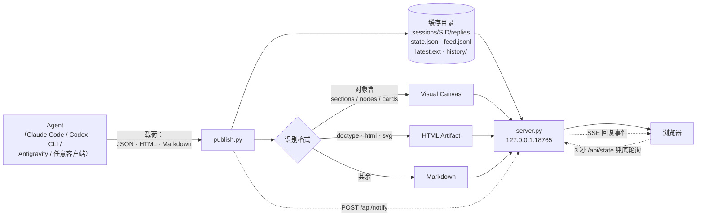

# Visual Reply

[](https://github.com/kyrie21z/visual-reply/actions/workflows/ci.yml)
[](https://www.python.org/)
[](LICENSE)

**把 AI Agent 的长篇终端回复，变成一个本地可交互的可视化网页。**

Visual Reply 是一个面向终端 / CLI 编码 Agent 的 Skill。它不再把六百字的答案倾倒进
scrollback，而是把结构化载荷发布到 `http://127.0.0.1:18765`，终端里只留一句结论和一个链接。
图表、拓扑图和评分卡在浏览器里渲染，所有长解释默认折叠进右侧抽屉，点开才展开。
同时开几个 Agent 也不打架：每个会话在同一个页面里各占一条泳道。
长任务还可以发布**实时面板**：同一个 ID 反复刷新，不刷屏、不占回复历史。

只依赖 Python 3.10+ 标准库。不需要 pip 安装，不需要 API Key，不上报任何数据，自身也不发起网络请求。

[English](README.md)

---

## 为什么是「视觉优先」，而不是「文字墙」

终端是很差的阅读界面：只有一列、没有版式、没有颜色语义、也没法并排比较。Agent 的回复越长，
这个问题越严重：

- **对比会塌陷。** 两个方案各六个维度，写成文字就是十二段话，读者得全部装进工作记忆才能比较。
  换成两张打分卡，同一个决策一眼看完。
- **结构会丢失。** 用散文描述架构，等于把图的还原工作丢给读者。拓扑图替他把这件事做了。
- **细节会淹没结论。** 长回复里的大部分内容是支撑那一句建议的论证。两者混排，读者要滑过结论去找
  前提，再滑回来。
- **什么都留不下。** 下一条命令就会把 scrollback 冲掉。本地页面保留最近 20 条归档，随时可回看。

Visual Reply 强制两级信息密度：**首屏不出现长句**——只有数字、节点和评分。其余内容全部放进
每个元素的 `details` 字段，在右侧 Inspector 抽屉里展开。这条约束才是产品本身，渲染器只是交付方式。

---

## 核心特性

### 三种载荷模式

| 模式 | `--format` | 效果 |
| --- | --- | --- |
| **Visual Canvas** | `json` | 用八类组件声明式搭建页面，可滚动、可点击，不用写一行 CSS |
| **HTML / SVG Artifact** | `html` | 自己的 HTML 放进 `sandbox="allow-scripts"` 的 iframe 渲染，可切换查看源码 |
| **Markdown 兼容模式** | `md` | 阅读 / 脑图 / 分屏三视图，支持 Mermaid 图表、标题折叠与表格 |

### 八类画布组件

| `type` | 视觉形态 | 适用场景 |
| --- | --- | --- |
| `kpis` | 指标卡，大数字 + 状态圆点 | 开门见山给关键数字 |
| `graph` | 分层节点拓扑 + SVG 贝塞尔箭头 | 架构、调用链、依赖、状态流转 |
| `comparison` | 方案卡 + 1–5 评分条 | 技术选型、方案取舍 |
| `bento` | Bento 网格，卡片可跨列 | 并列模块 / 能力总览 |
| `steps` | 横向阶段进度条 | 迁移步骤、执行计划、排查路径 |
| `table` | 科研表格：分组表头、最优/次优标记、基准 Δ、行内进度条、搜索排序、LaTeX / Markdown / CSV 导出 | 基准测试、消融实验、参数对照、进度看板 |
| `chart` | 纯 SVG 柱状 / 折线 / 散点 / 热力，tooltip、图例开关、帕累托前沿 | 趋势、分布、权衡关系、消融矩阵 |
| `prose` | Markdown 长文卡片，支持表格与外部链接 | 结论、方法、限制说明 |

### 科研画布

表格与图表全部离线绘制：不引入 Chart.js / ECharts / DataTables，不依赖 CDN，也不增加任何
第三方依赖。桌面端用两列栅格，`"span": 1` 的 section 并排显示；分屏或窗口窄于 960 px 时
自动回落单列。

- **表格**：点表头排序（缺失值无论升降序都沉底），搜索框只重绘 `tbody`，输入焦点不丢；
  `设为基准` 就地切换基准行并重算所有 Δ，不打开抽屉，点行本身才进 Inspector。`LaTeX`
  输出 `booktabs`（`\toprule` / `\midrule` / `\textbf` / `\underline` / `\multicolumn`），
  `Markdown` 与 `CSV` 按 RFC 4180 转义；剪贴板不可用时，导出内容始终保留在表格下方的预览框。
- **图表**：图例胶囊可点击隐藏系列；折线在 `null` 处拆成多段 SVG 路径；散点可选
  `max_y_min_x` / `max_xy` / `min_xy` 帕累托前沿并自动避让标签；热力按 `max_good` /
  `min_good` / `neutral` 归一化到 0–1 透明度。把 `details` / `files` 挂在系列、散点或热力格上，
  点击即可进右侧抽屉。
- **长文**：`prose` 复用 Markdown 渲染，自动包裹表格并把外链标记为 `target="_blank"`。

拓扑图的布局全自动，不需要额外字段：

- **列间距按内容自适应**：相邻两列之间的间隙由该层最长边标签估算（108–230 px），
  标签不会压在节点卡片上。
- **同列重心排序**：同列节点按上游前驱的平均行号排序，正反各跑一轮，消除大部分连线交叉。
- **Bypass 避让路由**：跨列长边走上通道，逆向回环与自环走下方通道；轨道间距 34 px，
  画布自动上下留白，任何边都不会横穿中间层节点。
- **标签独立成层**：边标签是 `z-index: 3` 的胶囊，不会被节点卡片切字；同一间隙内多条标签
  自动上下避让。
- **缩放工具栏**：图右上角 `适应 / 100% / − / +`，用 `transform: scale()` 实现，
  六列宽的图默认缩到 0.35 也能一屏看完。

### 点击下钻

每个节点、卡片、步骤都可以带 `details`（Markdown）和 `files`（等宽 chip）。点击后在右侧
Inspector 抽屉里展开完整说明、代码块和文件清单；`Esc` 或 `×` 关闭。鼠标悬停节点会高亮其上下游连线。

### 多会话工作台

每条回复都会归到某个会话，零配置推导：`--session` → `VISUAL_REPLY_SESSION` → 客户端线程变量
（`ANTIGRAVITY_CONVERSATION_ID`、`CODEX_THREAD_ID`、`OPENCODE_SESSION_ID`、
`GEMINI_SESSION_ID`、`CLAUDE_SESSION_ID`）→ 终端复用器面板（`WT_SESSION`、`TMUX_PANE`、
`WEZTERM_PANE`、`KITTY_WINDOW_ID`、`ITERM_SESSION_ID`）→ 父进程 + 项目根的哈希。
同一个 shell 稳定落在一个会话，换个终端自然分开。

- **左侧三级目录树**：顶部设有独立的 `★ 置顶` 分区，下方按「项目 → Session → Session 内回复」三层折叠展示；项目与 Session 按创建时间倒序**固定排位**（后台会话来新消息不乱跳），展开 Session 即可按时间倒序点选任意轮次（`#N (最新)` 永远贴顶）。顶部支持筛选 `全部 / 未读 / 置顶`，底部 `全局时间线` 汇总跨会话动态。
- **焦点锁（聚焦会话后的默认行为）**：点开会话或打开 `?session=` 深链后即锁定该会话。别的会话来新
  回复时**不会**抢占你正在读的窗格，只把左侧标未读并弹一个可点击的小提示。想看全局最新，点顶部切到
  `跟随全局`。
- **阅读守卫**：即使在当前会话内，只要 Inspector 抽屉开着、或正在回看历史轮次，新回复也只在顶部
  显示横幅「本会话有新回复 [切到最新]」，不关抽屉、不替换正在读的内容。
- **分屏**：会话卡片上的 `◫` 打开第二窗格。两个窗格各自保留会话、视图模式与回复轮次，共用一个抽屉。
- **回复轮次**：历史下拉列出当前会话的每一轮（`#3 (最新) · 标题`、`#2 · 标题`……），另附 v3 归档。

深链：`?session=<sid>&reply=<rid>`，可选 `&split=<sid2>`、`&layout=h|v`、`&mode=lock|global`。
发布回执里的 `url` 本身就是这样一条深链。

### 实时面板（Live Board）

不是所有回答都是一次性回复。训练进度、CI 构建、长任务心跳——这些要的是**一块持续刷新的看板**，
而不是二十条归档。加上 `--board` 后，同一 ID 的每次发布都会原地覆盖同一块面板：

```bash
# 第一次发布：创建面板
python3 scripts/publish.py --title "构建状态" --stdin \
  --board ci-live --board-name "CI 构建" --project "发布" --ttl 120 <<'JSON'
{
  "headline": "build 4821 · 3/5 阶段通过",
  "sections": [
    { "type": "table",
      "columns": [
        { "key": "stage", "label": "阶段" },
        { "key": "progress", "label": "进度", "bar": true, "max": 100, "unit": "%" },
        { "key": "tests", "label": "用例", "decimals": 0 }
      ],
      "rows": [
        { "id": "lint", "stage": "lint", "progress": { "value": 100, "sub": "done", "status": "ok" }, "tests": 0 },
        { "id": "unit", "stage": "unit", "progress": { "value": 78, "sub": "1402/1798" }, "tests": 1402 }
      ] }
  ]
}
JSON

# 之后每轮心跳：同一个 --board，换内容
python3 scripts/publish.py --title "构建状态" --stdin \
  --board ci-live --ttl 120 <<'JSON'
{ "headline": "build 4821 · 4/5 阶段通过", "sections": [ … ] }
JSON
```

- **与回复流隔离**：面板永远不写 `latest.*`、`meta.json`、`history/`、`sessions/` 和回复时间线，
  既不会污染全局动态，也不可能劫持窗格。回复与面板共用 `state.json` 的 `seq`，但事件分开落盘，
  SSE 帧分别标记为 `event: reply` 与 `event: board`。
- **标题粘性**：自定义 `--board-name` 首次给过就持久化，后续心跳只需要 ID 和载荷；
  `--project` 每次发布生效（缺省取会话项目）。
- **健康度状态机**：给了 `--ttl <秒>` 后，左栏卡片与窗格标题会按面板年龄推导状态：
  `LIVE`（age ≤ ttl）/ `STALE`（ttl < age ≤ 2×ttl）/ `OFFLINE`（更旧）；
  `--board-status complete` 固定为 `DONE`，`--board-status err` 固定为 `ALERT`；
  无 TTL 的面板显示 `BOARD`，带 `warn` 提示时显示 `WARN`。相对时间每 5 秒本地重算，不发请求。
- **左栏卡片**：面板与会话共用置顶 / 项目分组，卡片上带健康色点、`📊`、更新次数和相对时间；
  悬停出现 `★/☆` 置顶、`改` 重命名、`◫` 分屏；分屏目标列表里单独有「实时面板」分组。
- **原地刷新**：收到 `event: board` 时，只有正在看这块面板的窗格才重绘，滚动位置、表格排序 /
  搜索 / 基准 Δ、图表隐藏系列、拓扑缩放和已打开的 Inspector 抽屉全部保留；其它窗格只更新色点。
- **行内进度条**：列或单元格写 `"bar": true` 渲染进度条，`max` 为满格值，`sub` 显示小字副行；
  导出 LaTeX / Markdown / CSV 时只取数值。
- **深链**：`?board=<bid>` 聚焦面板，`?split=board:<bid>` 在右窗格分屏；面板回执里的 `url`
  已经带 `?board=`。

### 实时无刷更新

`publish.py` 提交后会 `POST /api/notify`，打开着的标签页通过 SSE 在 100ms 级刷新。
SSE 断线时自动降级为 3 秒 `/api/state?since=` 轮询，两者都不会手动 reload，也不会跳走滚动位置。

### 其他

- 浅色 / 深色主题切换，按浏览器记忆。
- 每次发布都按会话归档，同时投影出 v3 的 `history/`，历史下拉随时回看（最近 20 条）。
- 端口上若跑着旧版本服务，会自动 `SIGTERM` 接管并拉起当前版本。
- 服务只监听 `127.0.0.1`。
- 发布时顺带做长度检查：`headline` 或 `edge.label` 超长会在返回 JSON 里多一个 `warnings`
  数组，**不阻塞发布，退出码仍为 0**。

---

## 架构



`publish.py` 是唯一的写入方：解析会话 → 在 `.publish.lock` 上加排他锁 → 把回复写进
`sessions/<sid>/replies/` → 更新 `state.json` 与 `global/feed.jsonl` → 同步投影出 v3 的
`latest.<ext>` / `meta.json` / `history/` → 端口空闲时后台拉起 `server.py` → 唤醒 SSE。
`server.py` 除缓存目录外无状态，随时可以重启。

---

## 环境要求

- **Python 3.10+** —— 这就是全部依赖，不安装任何东西。
- **Node.js** —— 可选，只有测试套件的几何断言会用到。没有 `node` 时相关用例会跳过并明确报出。
- 自动打开浏览器需要桌面环境。无头机器上页面照常提供，自行打开 URL 或加 `--no-browser`。

---

## 安装

### 作为 Skill 安装（推荐）

```bash
npx skills add kyrie21z/visual-reply
```

### 手动安装

克隆一份，再软链到所用客户端。软链的好处是以后 `git pull` 直接生效，不用重新拷贝。

```bash
git clone https://github.com/kyrie21z/visual-reply.git ~/src/visual-reply

# Claude Code
mkdir -p ~/.claude/skills
ln -s ~/src/visual-reply ~/.claude/skills/visual-reply

# Codex CLI
mkdir -p ~/.codex/skills
ln -s ~/src/visual-reply ~/.codex/skills/visual-reply

# Antigravity
mkdir -p ~/.gemini/antigravity-cli/skills
ln -s ~/src/visual-reply ~/.gemini/antigravity-cli/skills/visual-reply

# 通用约定（~/.agents/skills）
mkdir -p ~/.agents/skills
ln -s ~/src/visual-reply ~/.agents/skills/visual-reply
```

Windows 上用管理员命令提示符建目录联接：

```bat
mklink /D "%USERPROFILE%\.claude\skills\visual-reply" "%USERPROFILE%\src\visual-reply"
```

不支持 Skill 机制的客户端，也可以直接当普通命令用，见下一节。

---

## 快速试跑

从 stdin 发布一个画布，下面是一行可直接复制的完整命令：

```bash
echo '{"headline":"采用方案 B：改动 12 个文件，不新增依赖","sections":[{"type":"kpis","items":[{"label":"改动文件","value":"12","status":"ok"},{"label":"新增依赖","value":"0","status":"ok"},{"label":"回滚耗时","value":"90s","status":"warn"}]},{"type":"comparison","title":"方案对比","items":[{"name":"方案 A：新建服务","scores":{"速度":2,"风险":4},"cons":["多一个部署目标"]},{"name":"方案 B：扩展中台","badge":"推荐","recommended":true,"scores":{"速度":4,"风险":2},"pros":["不新增部署目标"]}]}]}' | python3 scripts/publish.py --title "采用方案 B" --stdin
```

终端会收到这样的回执（已截断）：

```json
{
  "ok": true,
  "format": "json",
  "title": "采用方案 B",
  "url": "http://127.0.0.1:18765/?session=codex-7f3a&reply=20260101-120000-000001-B",
  "session_id": "codex-7f3a",
  "reply_id": "20260101-120000-000001-B",
  "seq": 1,
  "session_url": "http://127.0.0.1:18765/?session=codex-7f3a",
  "server": "started",
  "browser": "xdg-open"
}
```

再发布一次，已打开的页面会就地更新，通常在 100ms 级。

其他入口：

```bash
# 从文件读取，显式指定格式
python3 scripts/publish.py --title "调用链" --format json --file canvas.json

# 自定义 HTML 演示，放进 iframe 沙箱
python3 scripts/publish.py --title "交互原型" --format html --file demo.html

# 长文阅读，带 Mermaid 图与脑图
python3 scripts/publish.py --title "说明" --format md --file notes.md

# 只启动服务
python3 scripts/server.py --port 18765
```

工作目录不是仓库根目录时，用 `${SKILL_DIR}/scripts/publish.py`；`SKILL.md` 里写明了这个变量
的含义和各 shell 的设置方式。

---

## 画布 Schema

除 `type` 外所有字段均可选。

```json
{
  "title": "缺省时取 headline",
  "headline": "一句话核心结论，首屏最大字号",
  "badges": ["纯字符串也可", { "text": "决策就绪", "tone": "ok" }],
  "sections": [
    {
      "type": "graph",
      "title": "调用链拓扑",
      "nodes": [
        {
          "id": "cli", "label": "命令行入口", "tag": "cli", "layer": 0, "status": "ok",
          "summary": "解析参数后读取内容",
          "details": "## 细节\n\n支持 `--stdin` 与 `--file`。",
          "files": ["scripts/publish.py"]
        }
      ],
      "edges": [{ "from": "cli", "to": "store", "label": "内容" }]
    }
  ]
}
```

| 字段 | 取值 | 说明 |
| --- | --- | --- |
| `status`（node / kpi） | `ok` `warn` `err` `info` | 状态色点，缺省按 `info` |
| `status`（step） | `done` `active` `pending` | 进度条配色 |
| `tone`（card） | `accent` `ok` `warn` `err` | Bento 卡片描边与强调色 |
| `span`（card） | `1` `2` | 4 列栅格中的列宽 |
| `span`（section） | `1` `2` | 两列栅格中占 1 列或整行；分屏 / 窄屏回落整行 |
| `columns[]` | `key` / `label` / `align` / `highlight` / `higher_is_better` / `decimals` / `unit` / `delta_unit` / `bar` / `max` | 表格列定义；`higher_is_better` 决定最优方向与 Δ 色调；`bar: true` 渲染行内进度条，`max` 为满格值 |
| `rows[]` | `id` / `cells` / `is_baseline` / `emphasis` / `divider_before` / `details` / `files` | 单元格可写原始值，或 `{value, display, note, status, bar, max, sub}`；`sub` 为小字副行，导出只取数值 |
| `chart_type` | `bar` `line` `scatter` `heatmap` | 图表类型，缺省 `bar` |
| `scores` | `{ "维度": 1..5 }` | 渲染成进度条，不要再写文字形容高低 |
| `layer` | 从 0 开始的整数 | 缺省时按 edges 拓扑排序自动分层 |
| `details` | Markdown 字符串 | 右侧抽屉内渲染 |
| `files` | 字符串数组 | 抽屉内以等宽 chip 展示 |
| `node.label` | ≤ 12 字 | 两行自动换行，超出省略 |
| `edge.label` | ≤ 10 字 | 胶囊标签，超 14 字触发 `warnings` |

顶层只有一张图时，可以直接写成 `{ "headline": …, "nodes": [...], "edges": [...] }`；
`cards` / `steps` / `kpis` 同理。表格可把 `columns` 与 `rows` 放顶层，图表可把 `chart_type`
（或 `matrix` + `x_labels`）放顶层。自动识别规则：能解析为对象且含 `sections` / `nodes` /
`cards` / `columns`+`rows` / `chart_type` / `matrix`+`x_labels` 即视为 json；只有 `prose`
字段时需要显式 `--format json`。

---

## 参数

| 参数 | 说明 |
| --- | --- |
| `--title` | 标题。缺省时 json 取 `title`/`headline`，html 取 `<title>`，md 取第一个 H1 |
| `--format` | `auto`（默认）/ `json` / `html` / `md` |
| `--file` | 从文件读取载荷 |
| `--stdin` | 从标准输入读取（stdin 不是 TTY 时也会自动启用） |
| `--no-browser` | 不自动打开浏览器 |
| `--port` | 服务端口，默认 `18765` |
| `--cache-dir` | 缓存目录，默认 `~/.cache/agent-visual-reply` |
| `--public-url` | 回执使用的公开 HTTPS 基地址（如 `https://vr.example.com`）；缺省依次读 `VISUAL_REPLY_PUBLIC_URL` 与 `<cache-dir>/config.json` |
| `--session` | 会话 ID，显式指定后跳过自动检测；非法 ID 直接拒绝 |
| `--session-name` | 会话显示名，持久化到 `session.json` |
| `--agent` | 客户端徽标（`codex` / `claude` / `antigravity` …） |
| `--board` | 实时面板 ID；同一 ID 重复发布原地更新，不再追加回复 |
| `--board-name` | 面板显示名（粘性：首次给过后，后续更新不传也保留） |
| `--project` | 显式项目分组名（对面板与会话都生效） |
| `--ttl` | 新鲜度窗口（秒）；`0`（默认）表示静态面板 / 不过期 |
| `--board-status` | 可选状态提示：`ok` / `warn` / `err` / `complete` |
| `--open-browser` | 面板模式下也强制打开浏览器（回复模式本来就会打开） |

### 公开地址

页面经隧道或反向代理暴露到公网时，给 `publish.py` 设置一次公开基地址即可：`--public-url https://vr.example.com`、
环境变量 `VISUAL_REPLY_PUBLIC_URL`，或 `<cache-dir>/config.json` 里的
`{"public_url": "https://vr.example.com"}`（越靠前优先级越高）。取值必须是带主机名的 `http` / `https`；
query、fragment 与末尾斜杠会被丢弃，非法值安全回退为本地链接。生效后回执的 `url` / `base_url` /
`session_url` 使用公开深链，并额外给出本机等价的 `local_url` / `local_base_url` / `local_session_url`
与 `public_url` / `public_base_url`（未配置时为 `null`）；浏览器始终只打开本地地址。

缓存结构：

```text
~/.cache/agent-visual-reply/
├── .publish.lock                          # 写锁：跨平台排他锁（flock / msvcrt.locking）
├── .server.lock                           # 启动锁：冷启动串行化
├── state.json                             # version 7 / seq / 最新会话与回复指针
├── sessions/
│   └── <sid>/
│       ├── session.json                   # label / client / project / pinned / seq / reply_count
│       └── replies/
│           ├── 20260101-120000-000001-标题.md
│           └── 20260101-120000-000001-标题.md.meta.json
├── boards/                                # v7 实时面板：每块面板一个目录
│   └── <bid>/
│       ├── board.json                     # label / project / pinned / ttl_sec / status_hint / update_count / seq
│       └── payload.json | .md | .html     # 原地覆盖；切换格式时删除旧扩展名
├── global/feed.jsonl                      # 追加式跨会话回复时间线
├── global/board_events.jsonl              # 面板事件流，截断到最近 200 条
├── latest.json | latest.html | latest.md  # v3 投影，按格式只写其一
├── meta.json                              # v3 投影，额外带 seq / session_id / reply_id
├── server.log
└── history/                               # v3 投影，旧客户端照常读
    ├── 20260101-120000-标题.json
    ├── 20260101-120000-标题.json.meta.json
    └── 20260101-090000-旧内容.md
```

`reply_id` 形如 `<时间戳>-<seq:06d>-<ASCII 片段>`：可排序、并发下唯一、可直接拼进 URL。
回复与面板共用 `state.json` 的 `seq`，但事件分开落盘：`/api/feed` 与左栏时间线永远不含面板刷新。

---

## 服务接口

| 接口 | 返回 |
| --- | --- |
| `GET /` | 单页应用 |
| `GET /api/latest` | `{version, format, title, content, mtime, updated_at}` |
| `GET /api/history` | `{version, items: [...], count}`，最近 20 条 |
| `GET /api/history/<filename>` | `{format, title, content, updated_at, mtime}` |
| `GET /artifact/latest` | 当前 HTML Artifact 原文，`text/html; charset=utf-8`；非 html 格式返回 404 |
| `GET /artifact/history/<filename>` | 历史 HTML Artifact 原文 |
| `GET /api/sessions` | `{version, seq, latest_session_id, sessions, boards, legacy_count}`，置顶优先、其后按新到旧 |
| `GET /api/sessions/<sid>/replies?limit=200` | 某会话的回复轮次，最新在前 |
| `GET /api/sessions/<sid>/replies/<rid>` | `{version, session, reply, content}` |
| `GET /api/boards` | `{version, seq, boards, count}` |
| `GET /api/boards/<bid>` | `{version, board, content}`；非法 ID 400，不存在 404 |
| `POST /api/boards/<bid>` | 更新 `{label, pinned}`；400 / 404 同上 |
| `GET /artifact/board/<bid>` | 面板 HTML 原文，`text/html; charset=utf-8`；非 html 格式 404 |
| `GET /api/feed?limit=50` | 跨会话回复时间线（含未归入会话的 v3 归档，不含面板刷新） |
| `GET /api/state?since=<seq>` | 断线补播的增量事件（回复 + 面板按 seq 合并） |
| `GET /api/events` | SSE 流（`text/event-stream`，20 秒 keepalive）；回复发 `event: reply`，面板发 `event: board` |
| `POST /api/notify` | 发布后立即唤醒 SSE |
| `POST /api/sessions/<sid>` | 原子更新 `{label, pinned}` |
| `GET /artifact/session/<sid>/<rid>` | 会话回复的 HTML 原文 |
| `GET /healthz` | `{ok, service, version, pid, port, cache_dir, seq}` |

---

## 测试

```bash
python3 scripts/test_visual_reply.py
```

端到端测试：在随机空闲端口和临时目录上启动真实服务，结束后全部清理。覆盖三种格式、auto 识别、
八类组件元数据、前端组件存在性、artifact 接口、混合格式历史排序、路径穿越防护、旧版服务接管、
长度提醒，以及开源卫生扫描。装好 `node` 时，还会用页面里的纯几何核心跑一张六列回环拓扑，
断言越界、穿模、列间距与标签叠字。

v4 追加：所有会话识别来源与深链回执格式；8 进程并发跨 3 个会话发布（全部退出 0、零丢回复、
seq `1..8`、sidecar 全可解析）；SSE 连接 → 2 秒内实时推送 → `/api/state` 补播 →
挂着客户端 `SIGTERM` 1.5 秒内退出；会话置顶/重命名与 `/api/sessions/..`、`/artifact/session/..`
穿越拒绝；以及工作台每个渲染器「只有一份实现」的结构断言。

v6 追加：Node VM 里的 `TableCore`（并列排名、双向 Δ、缺失值沉底、LaTeX 转义、Markdown /
RFC 4180 CSV）与 `ChartCore`（常规/负数/常量/空区间刻度、柱体边界、null 断线、隐藏系列、
帕累托前沿、热力归一化），以及完整科研画布的发布 / 回读与 table/chart/prose 简写识别。

v7 追加：Node VM 里的面板健康度状态机与相对时间格式（全部分支、TTL 边界、epoch / ISO
时间戳、`刚刚` / `s` / `m` / `h` 格式）；面板感知的目录树（置顶面板、纯面板项目分组、
未读筛选、置顶面板不重复计数）；行内表格进度条（`bar` / `max` / `sub` 解析与纯数值导出）；
幂等面板发布回读，证明回复侧完全不受影响（`latest.*` / `meta.json` / `history/` / 回复流
均不变）；`/api/boards` 列表 / 读取 / 置顶重命名接口；`/api/boards/..` 与
`/artifact/board/..` 路径穿越拒绝；`event: board` SSE 推送；HTML 面板 artifact 路由。

不需要联网。

---

## 排错

| 现象 | 处理 |
| --- | --- |
| `ok: false`、退出码 2、端口被占 | 换端口：`--port 18800` |
| 旧版服务没被接管 | 健康检查缺少 `pid` 时会拒绝自动接管，手动结束该进程 |
| 服务起不来 | 先看报错末尾，再看 `~/.cache/agent-visual-reply/server.log` |
| 画布空白 | JSON 顶层必须是含 `sections` / `nodes` / `cards` 的对象；解析失败会回落到 Markdown |
| 节点分层不理想 | 显式给 `layer`，不要让有环图自动推断 |
| 宽图右侧看不全 | 点拓扑图右上角「适应」按容器宽度缩放（最低 0.35×） |
| 图表 / 脑图不显示 | Markdown 模式从 jsDelivr 加载 `marked`、`mermaid`、`markmap`，离线时退化为纯文本；JSON 画布除抽屉内 Markdown 外不依赖 CDN |
| 改了内容但页面没变 | 确认端口与 `--cache-dir` 一致；右上角状态点应显示「已同步」 |
| 新回复没有自动出现 | 状态点显示「实时断线」时说明 SSE 被挡，3 秒轮询会自动接管 |
| 一个 Agent 变成好几个会话 | 父进程或终端面板变了；用 `--session` / `--session-name` 固定 |
| 发布跑到别的会话里 | 环境里残留了 `CODEX_THREAD_ID`、`CLAUDE_SESSION_ID` 等；`--session` 永远优先 |
| 面板一直是 `OFFLINE` | 每轮心跳要带同一个 `--board`，且 `--ttl` 至少是心跳间隔的两倍 |
| 面板更新把你正在读的窗格刷掉了 | 正常不会：焦点锁下只有正在看该面板的窗格才原地重绘；若切到了 `跟随全局`，切回 `锁定会话` |

---

## 许可证

MIT © 2026 kyrie21z，详见 [LICENSE](LICENSE)。
