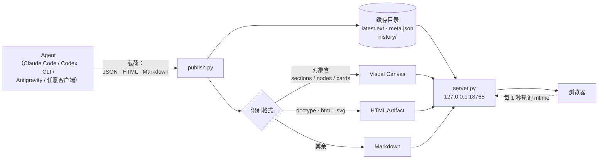

# Visual Reply

[](https://github.com/kyrie21z/visual-reply/actions/workflows/ci.yml)
[](https://www.python.org/)
[](LICENSE)

**把 AI Agent 的长篇终端回复，变成一个本地可交互的可视化网页。**

Visual Reply 是一个面向终端 / CLI 编码 Agent 的 Skill。它不再把六百字的答案倾倒进
scrollback，而是把结构化载荷发布到 `http://127.0.0.1:18765`，终端里只留一句结论和一个链接。
图表、拓扑图和评分卡在浏览器里渲染，所有长解释默认折叠进右侧抽屉，点开才展开。

只依赖 Python 3.10+ 标准库。不需要 pip 安装，不需要 API Key，不上报任何数据，自身也不发起网络请求。

[English](README.md)

---

## 为什么是「视觉优先」，而不是「文字墙」

终端是很差的阅读界面：只有一列、没有版式、没有颜色语义、也没法并排比较。Agent 的回复越长，
这个问题越严重：

- **对比会塌陷。** 两个方案各六个维度，写成文字就是十二段话，读者得全部装进工作记忆才能比较。
  换成两张打分卡，同一个决策一眼看完。
- **结构会丢失。** 用散文描述架构，等于把图的还原工作丢给读者。拓扑图替他把这件事做了。
- **细节会淹没结论。** 长回复里的大部分内容是支撑那一句建议的论证。两者混排，读者要滑过结论去找
  前提，再滑回来。
- **什么都留不下。** 下一条命令就会把 scrollback 冲掉。本地页面保留最近 20 条归档，随时可回看。

Visual Reply 强制两级信息密度：**首屏不出现长句**——只有数字、节点和评分。其余内容全部放进
每个元素的 `details` 字段，在右侧 Inspector 抽屉里展开。这条约束才是产品本身，渲染器只是交付方式。

---

## 核心特性

### 三种载荷模式

| 模式 | `--format` | 效果 |
| --- | --- | --- |
| **Visual Canvas** | `json` | 用五类组件声明式搭建页面，可滚动、可点击，不用写一行 CSS |
| **HTML / SVG Artifact** | `html` | 自己的 HTML 放进 `sandbox="allow-scripts"` 的 iframe 渲染，可切换查看源码 |
| **Markdown 兼容模式** | `md` | 阅读 / 脑图 / 分屏三视图，支持 Mermaid 图表、标题折叠与表格 |

### 五类画布组件

| `type` | 视觉形态 | 适用场景 |
| --- | --- | --- |
| `kpis` | 指标卡，大数字 + 状态圆点 | 开门见山给关键数字 |
| `graph` | 分层节点拓扑 + SVG 贝塞尔箭头 | 架构、调用链、依赖、状态流转 |
| `comparison` | 方案卡 + 1–5 评分条 | 技术选型、方案取舍 |
| `bento` | Bento 网格，卡片可跨列 | 并列模块 / 能力总览 |
| `steps` | 横向阶段进度条 | 迁移步骤、执行计划、排查路径 |

拓扑图的布局全自动，不需要额外字段：

- **列间距按内容自适应**：相邻两列之间的间隙由该层最长边标签估算（108–230 px），
  标签不会压在节点卡片上。
- **同列重心排序**：同列节点按上游前驱的平均行号排序，正反各跑一轮，消除大部分连线交叉。
- **Bypass 避让路由**：跨列长边走上通道，逆向回环与自环走下方通道；轨道间距 34 px，
  画布自动上下留白，任何边都不会横穿中间层节点。
- **标签独立成层**：边标签是 `z-index: 3` 的胶囊，不会被节点卡片切字；同一间隙内多条标签
  自动上下避让。
- **缩放工具栏**：图右上角 `适应 / 100% / − / +`，用 `transform: scale()` 实现，
  六列宽的图默认缩到 0.35 也能一屏看完。

### 点击下钻

每个节点、卡片、步骤都可以带 `details`（Markdown）和 `files`（等宽 chip）。点击后在右侧
Inspector 抽屉里展开完整说明、代码块和文件清单；`Esc` 或 `×` 关闭。鼠标悬停节点会高亮其上下游连线。

### 1 秒无刷热更新

页面每秒轮询一次 `mtime`。再次发布到同一端口和同一缓存目录时，已打开的标签页会就地刷新，
不用手动 reload，也不会跳走滚动位置。

### 其他

- 浅色 / 深色主题切换，按浏览器记忆。
- 最近 20 次发布在本地归档，从历史下拉框随时回看。
- 端口上若跑着旧版本服务，会自动 `SIGTERM` 接管并拉起当前版本。
- 服务只监听 `127.0.0.1`。
- 发布时顺带做长度检查：`headline` 或 `edge.label` 超长会在返回 JSON 里多一个 `warnings`
  数组，**不阻塞发布，退出码仍为 0**。

---

## 架构



`publish.py` 是唯一的写入方：校验载荷、原子写入 `latest.<ext>` 与 `meta.json`、在 `history/`
下归档一份、端口空闲时后台拉起 `server.py`，最后输出 JSON 回执。`server.py` 除缓存目录外无状态，
随时可以重启。

---

## 环境要求

- **Python 3.10+** —— 这就是全部依赖，不安装任何东西。
- **Node.js** —— 可选，只有测试套件的几何断言会用到。没有 `node` 时相关用例会跳过并明确报出。
- 自动打开浏览器需要桌面环境。无头机器上页面照常提供，自行打开 URL 或加 `--no-browser`。

---

## 安装

### 作为 Skill 安装（推荐）

```bash
npx skills add kyrie21z/visual-reply
```

### 手动安装

克隆一份，再软链到所用客户端。软链的好处是以后 `git pull` 直接生效，不用重新拷贝。

```bash
git clone https://github.com/kyrie21z/visual-reply.git ~/src/visual-reply

# Claude Code
mkdir -p ~/.claude/skills
ln -s ~/src/visual-reply ~/.claude/skills/visual-reply

# Codex CLI
mkdir -p ~/.codex/skills
ln -s ~/src/visual-reply ~/.codex/skills/visual-reply

# Antigravity
mkdir -p ~/.gemini/antigravity-cli/skills
ln -s ~/src/visual-reply ~/.gemini/antigravity-cli/skills/visual-reply

# 通用约定（~/.agents/skills）
mkdir -p ~/.agents/skills
ln -s ~/src/visual-reply ~/.agents/skills/visual-reply
```

Windows 上用管理员命令提示符建目录联接：

```bat
mklink /D "%USERPROFILE%\.claude\skills\visual-reply" "%USERPROFILE%\src\visual-reply"
```

不支持 Skill 机制的客户端，也可以直接当普通命令用，见下一节。

---

## 快速试跑

从 stdin 发布一个画布，下面是一行可直接复制的完整命令：

```bash
echo '{"headline":"采用方案 B：改动 12 个文件，不新增依赖","sections":[{"type":"kpis","items":[{"label":"改动文件","value":"12","status":"ok"},{"label":"新增依赖","value":"0","status":"ok"},{"label":"回滚耗时","value":"90s","status":"warn"}]},{"type":"comparison","title":"方案对比","items":[{"name":"方案 A：新建服务","scores":{"速度":2,"风险":4},"cons":["多一个部署目标"]},{"name":"方案 B：扩展中台","badge":"推荐","recommended":true,"scores":{"速度":4,"风险":2},"pros":["不新增部署目标"]}]}]}' | python3 scripts/publish.py --title "采用方案 B" --stdin
```

终端会收到这样的回执：

```json
{
  "ok": true,
  "format": "json",
  "title": "采用方案 B",
  "url": "http://127.0.0.1:18765",
  "server": "started",
  "browser": "xdg-open"
}
```

再发布一次，已打开的页面会在一秒内自动更新。

其他入口：

```bash
# 从文件读取，显式指定格式
python3 scripts/publish.py --title "调用链" --format json --file canvas.json

# 自定义 HTML 演示，放进 iframe 沙箱
python3 scripts/publish.py --title "交互原型" --format html --file demo.html

# 长文阅读，带 Mermaid 图与脑图
python3 scripts/publish.py --title "说明" --format md --file notes.md

# 只启动服务
python3 scripts/server.py --port 18765
```

工作目录不是仓库根目录时，用 `${SKILL_DIR}/scripts/publish.py`；`SKILL.md` 里写明了这个变量
的含义和各 shell 的设置方式。

---

## 画布 Schema

除 `type` 外所有字段均可选。

```json
{
  "title": "缺省时取 headline",
  "headline": "一句话核心结论，首屏最大字号",
  "badges": ["纯字符串也可", { "text": "决策就绪", "tone": "ok" }],
  "sections": [
    {
      "type": "graph",
      "title": "调用链拓扑",
      "nodes": [
        {
          "id": "cli", "label": "命令行入口", "tag": "cli", "layer": 0, "status": "ok",
          "summary": "解析参数后读取内容",
          "details": "## 细节\n\n支持 `--stdin` 与 `--file`。",
          "files": ["scripts/publish.py"]
        }
      ],
      "edges": [{ "from": "cli", "to": "store", "label": "内容" }]
    }
  ]
}
```

| 字段 | 取值 | 说明 |
| --- | --- | --- |
| `status`（node / kpi） | `ok` `warn` `err` `info` | 状态色点，缺省按 `info` |
| `status`（step） | `done` `active` `pending` | 进度条配色 |
| `tone`（card） | `accent` `ok` `warn` `err` | Bento 卡片描边与强调色 |
| `span`（card） | `1` `2` | 4 列栅格中的列宽 |
| `scores` | `{ "维度": 1..5 }` | 渲染成进度条，不要再写文字形容高低 |
| `layer` | 从 0 开始的整数 | 缺省时按 edges 拓扑排序自动分层 |
| `details` | Markdown 字符串 | 右侧抽屉内渲染 |
| `files` | 字符串数组 | 抽屉内以等宽 chip 展示 |
| `node.label` | ≤ 12 字 | 两行自动换行，超出省略 |
| `edge.label` | ≤ 10 字 | 胶囊标签，超 14 字触发 `warnings` |

顶层只有一张图时，可以直接写成 `{ "headline": …, "nodes": [...], "edges": [...] }`；
`cards` 同理。自动识别规则：能解析为对象且含 `sections` / `nodes` / `cards` 即视为 json。

---

## 参数

| 参数 | 说明 |
| --- | --- |
| `--title` | 标题。缺省时 json 取 `title`/`headline`，html 取 `<title>`，md 取第一个 H1 |
| `--format` | `auto`（默认）/ `json` / `html` / `md` |
| `--file` | 从文件读取载荷 |
| `--stdin` | 从标准输入读取（stdin 不是 TTY 时也会自动启用） |
| `--no-browser` | 不自动打开浏览器 |
| `--port` | 服务端口，默认 `18765` |
| `--cache-dir` | 缓存目录，默认 `~/.cache/agent-visual-reply` |

缓存结构：

```text
~/.cache/agent-visual-reply/
├── latest.json | latest.html | latest.md   # 按格式只写其一
├── meta.json                               # version / format / title / mtime / chars
├── server.log
└── history/
    ├── 20260101-120000-标题.json
    ├── 20260101-120000-标题.json.meta.json  # 独立 sidecar，不与载荷冲突
    └── 20260101-090000-旧内容.md
```

---

## 服务接口

| 接口 | 返回 |
| --- | --- |
| `GET /` | 单页应用 |
| `GET /api/latest` | `{version, format, title, content, mtime, updated_at}` |
| `GET /api/history` | `{version, items: [...], count}`，最近 20 条 |
| `GET /api/history/<filename>` | `{format, title, content, updated_at, mtime}` |
| `GET /artifact/latest` | 当前 HTML Artifact 原文，`text/html; charset=utf-8`；非 html 格式返回 404 |
| `GET /artifact/history/<filename>` | 历史 HTML Artifact 原文 |
| `GET /healthz` | `{ok, service, version, pid, port, cache_dir}` |

---

## 测试

```bash
python3 scripts/test_visual_reply.py
```

端到端测试：在随机空闲端口和临时目录上启动真实服务，结束后全部清理。覆盖三种格式、auto 识别、
五类组件元数据、前端组件存在性、artifact 接口、混合格式历史排序、路径穿越防护、旧版服务接管、
长度提醒，以及开源卫生扫描。装好 `node` 时，还会用页面里的纯几何核心跑一张六列回环拓扑，
断言越界、穿模、列间距与标签叠字。

不需要联网。

---

## 排错

| 现象 | 处理 |
| --- | --- |
| `ok: false`、退出码 2、端口被占 | 换端口：`--port 18800` |
| 旧版服务没被接管 | 健康检查缺少 `pid` 时会拒绝自动接管，手动结束该进程 |
| 服务起不来 | 先看报错末尾，再看 `~/.cache/agent-visual-reply/server.log` |
| 画布空白 | JSON 顶层必须是含 `sections` / `nodes` / `cards` 的对象；解析失败会回落到 Markdown |
| 节点分层不理想 | 显式给 `layer`，不要让有环图自动推断 |
| 宽图右侧看不全 | 点拓扑图右上角「适应」按容器宽度缩放（最低 0.35×） |
| 图表 / 脑图不显示 | Markdown 模式从 jsDelivr 加载 `marked`、`mermaid`、`markmap`，离线时退化为纯文本；JSON 画布除抽屉内 Markdown 外不依赖 CDN |
| 改了内容但页面没变 | 确认端口与 `--cache-dir` 一致；右上角状态点应显示「已同步」 |

---

## 许可证

MIT © 2026 kyrie21z，详见 [LICENSE](LICENSE)。
